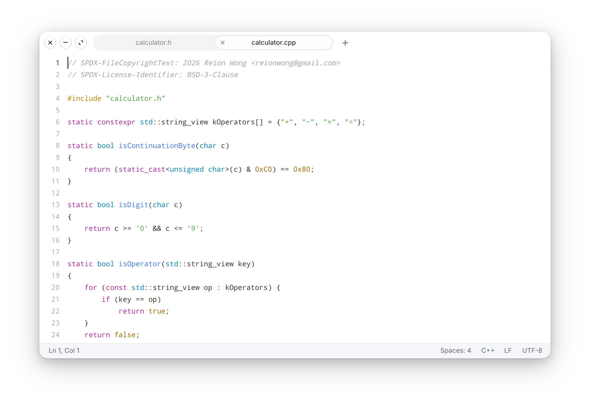

# Text Editor

A simple text editor for Cutefish Desktop, made for quick edits such as a
configuration file or a note. It has tabs, find and replace, encoding
detection and syntax highlighting for common languages, and is not meant to
replace a code editor.



## Dependencies

cutefish-toolkit, ICU and PCRE2; GoogleTest for the tests.

```shell
sudo apt install cmake libicu-dev libpcre2-dev libgtest-dev
```

## Build

```shell
mkdir build
cd build
cmake -DCMAKE_INSTALL_PREFIX:PATH=/usr ..
make
```

## Install

```shell
sudo make install
```

## Tests

```shell
cmake -DBUILD_TESTING=ON ..
make
ctest
```

## License

BSD-3-Clause; see [LICENSE](LICENSE).
